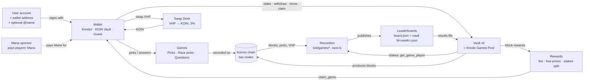

# Knode Games — Dependencies

> **Purpose:** how the seven parts of Knode Games connect — Vault, Leaderboards, Rewards, Swap Desk, Wallets, Games and User Accounts — so a change to one part shows what it can affect.
> **Last updated:** 5 Nov 2026 (status sync: sponsor numbers point to `SPONSOR.md`; Daily Questions on the Stake page; new games paused, D-113)
> **Built from:** `DECISIONS.md` (D-xxx), `ARCHITECTURE.md`, the standards in `../standards/`, and the repo. Detail lives there; this file shows the links.

**Legend:** ✅ verified in the repo · 💬 from a chat · ❓ unknown · **→** "depends on / sends to"

## 1. The seven parts
| Part | What it is | Where it lives |
|------|-----------|----------------|
| **User account** | Not a login: a player *is* a Koinos wallet address. Optional display name = Koinos @name (D-030). The site keeps only public data in the browser (`kw-accounts`, `kw-active`, `kw-kind`) — never keys | the chain; `wallet.js`; `names.json` |
| **Wallet** | How a player signs: Kondor (extension), KOIN Vault (mobile), or the site's Guest wallet (play-only, no funds). Plus the Mana sponsor, which pays Mana for players | `wallet.js` (`KWallet`), `header-wallet.js`, `guest.js`; sponsor `1ByDDS…` |
| **Games** | Nine games (three live: Questions, Block X, Race; the rest paused, D-113). Picks go to the Picks contract (or the Race picks contract; Questions answers go to the vault itself); each game's recorder turns chain data into results | Picks `1LmgqB…`, Race `1EN7xU…`, vault `1Mpmf2…`; `bot/games/*`, `race.ts` |
| **Leaderboard** | Each game's published board (Staked / Free play), plus the weekly vault results file | data branches (`race-data`, `games-data`); `board.js` |
| **Vault** | Holds every staked VHP, produces blocks as the **Knode Games Pool** (D-073), and pays rewards | `1Mpmf2ERhjYpX7CCiM11WERuM4j17uT1sr`; `bot/vault.ts` |
| **Rewards** | The weekly money: block rewards → 5% fee → free prizes → staked split by game → claims | inside the vault; claimed through the stake panel |
| **Swap Desk** | A separate contract: VHP → KOIN at a flat 3%, refilled by its own node's production (D-044) | `1FKTpX…`; `swap.html` |

## 2. The map

## 3. Relationship matrix
Read across: how the row part depends on or feeds the column part.

| | User account | Wallet | Games | Leaderboard | Vault | Rewards | Swap Desk |
|---|---|---|---|---|---|---|---|
| **User account** | — | is the wallet's address | identified by address in every pick | shown by @name + short address | identified by address in stakes | paid to the address | swaps from the address |
| **Wallet** | signs for the address | — | sends picks and answers (sponsored) | — | stake, withdraw, move, claim | receives claims | sends VHP, gets KOIN |
| **Games** | rank addresses | need a signing wallet; sponsor pays plays | — | recorder writes the board | need vault registration to pay; read stakes | define how a game's share is split | Combo / Block X / Race read nothing from it |
| **Leaderboard** | lists addresses | — | built from each game's results | — | Staked board needs stake reads | medals mark who earns | — |
| **Vault** | holds each address's stakes | is called by the wallet | registers games (`vaultGames`) | reads the results file | — | produces and pays them | separate contract, separate funds |
| **Rewards** | go to addresses | arrive via `claim_game` | split by each game's staked weight | ranked from the results file | come only from the vault | — | — |
| **Swap Desk** | trades with addresses | needs a signing wallet; pays its own Mana | — | — | none — kept separate (D-044) | none | — |

## 4. Each connection
| # | From → To | How | Rule | If it breaks |
|---|-----------|-----|------|--------------|
| 1 | User account → Wallet | an address belongs to a Kondor, KOIN Vault or Guest key; the site remembers only public data | D-009 | the player reconnects; nothing on chain is lost |
| 2 | User account → @name | name from the Koinos Nicknames contract, else a pool name; the short address always shows | D-030 | the board shows the address only |
| 3 | Wallet → Mana sponsor | `sponsorFor()` names the sponsor as payer only if it covers every operation, within its caps (live values: `SPONSOR.md`) | D-027, D-028, D-061 | past the caps, players pay their own Mana; guests can't |
| 4 | Wallet → Games | picks to the Picks contract (or Race picks); answers to the vault (game 1); locks enforced on chain | GAME_STANDARD §4–5 | a pick after lock is refused by the chain |
| 5 | Wallet → Vault | `approve` + `deposit_to` (whole VHP, KOIN may burn 1:1), `withdraw_from` any time, `move_stake`, `claim_game` | D-016, D-027 | withdrawals always work (emergency build, D-021) |
| 6 | Wallet → Swap Desk | sends VHP, receives KOIN minus 3%; the desk pays its own Mana | D-007, D-039, D-044 | a swap pays at most min(desk KOIN, desk Mana) |
| 7 | Games → Chain → Recorders | recorders read blocks and picks on **two agreeing nodes**, irreversible blocks only, with no keys | GAME_STANDARD §6 | nodes disagree → no final file (fail closed) |
| 8 | Vault → Recorders | stake reads `get_game_player` / `get_player` / `get_state` on two nodes decide Staked vs Free | VAULT_STANDARD §4 | read fails → no final file, never "not staked" |
| 9 | Recorders → Leaderboard | publish job (no repo code) writes `board.json`, final weeks frozen | LEADERBOARD_STANDARD §5 | a bad file is held; others still publish |
| 10 | Leaderboard → Vault | weekly results file `W<week>.json` from the game's `vaultGames` source; the bot posts it (when: `../standards/WEEK_CYCLE.md`) | VAULT_STANDARD §6 | missing after 3 days → week missed, no pay; HOLD files pause payment |
| 11 | Vault → Chain | the vault's VHP produces blocks as the Knode Games Pool, through the game node on the owner's PC | D-073 | node down → fewer blocks, smaller rewards; stakes untouched |
| 12 | Vault → Rewards | block rewards − 5% fee → free prizes (2 + 1 per week per game with its free prize allowed; the D-082 switch decides whether winners are posted) → the rest split across staked games by weight | D-029, D-062, D-081, D-082 | shortfall is cut, never owed |
| 13 | Rewards → Wallet | the player claims (`claim_game`, up to 10 per transaction, 52 weeks back); the vault never pushes funds | TOKEN_STANDARD §5 | unclaimed rewards wait in the vault |
| 14 | Games → Games | Block Golf reads other games' boards; Combo reads Race and Block X results; Block X and Last Node read Race handicap cards; Fantasy and Last Node need the VHP sampler | D-056, D-060, I-059 | an upstream game's failure voids or skips the downstream hole, leg or card |
| 15 | Swap Desk ↔ Vault | **no link**: separate contracts, separate node, separate funds | D-044 | one can stop without affecting the other |

## 5. End-to-end flows
**Free player (no funds)**
Guest or any wallet → picks or answers, Mana paid by the sponsor → recorder → Free play board → top 2 named in the vault file's `first` / `second` → 2 + 1 VHP (D-062) → claimed into the wallet. *The bot posts the free winners only when that game's free-prize switch is ON (D-082): today Questions (built in), Block X, Race, Bracket, Last Node. Combo, Golf, Survivor and Fantasy have the board but no prize for now (D-081). An unpaid prize returns, fee-free, to the next week's pot. (Was D-071: "only on free games" — superseded.)*

**Staked player**
Kondor or KOIN Vault → `approve` + `deposit_to` into game N → plays → recorder reads the stake (Staked board) → vault file `rows` with points → vault splits the game's share → `claim_game`. Players can stake in as many games as they like, 1 VHP minimum each — encouraged (D-074). Withdraw any time; withdrawing below 1 VHP mid-week forfeits that week (I-028).

**Weekly money**
Knode Games Pool produces blocks → rewards in the vault → 5% fee (`claim-fee-vhp all`) → free prizes → each staked game's share by staked weight → each game's rules split it → claims.

**Swap**
VHP holder → Swap Desk → KOIN back (−3%) → the desk's VHP keeps producing on its own node, refilling KOIN. Never touches the vault.

## 6. What depends on what (blast radius)
| If this is down… | …these stop or wait | …and these keep working |
|------------------|---------------------|-------------------------|
| A Koinos node (one of two) | final results, stake reads, vault files (fail closed) | stakes, withdrawals, picks |
| The Mana sponsor | free (guest) play; sponsored stake/claim | paid transactions with the player's own Mana |
| The VHP sampler (running since 3 Nov 15:58 UTC; up to 12 samples a run since PR #67) | Last Node launch; Fantasy and Combo price cards | Questions, Race, Block X targets after warm-up |
| The Race | Combo race legs, Block X / Last Node handicap cards, the Golf Race hole | Questions, the vault, withdrawals |
| A game's recorder | that game's board and vault file (week may be missed after 3 days) | every other game; the vault |
| The game node on the owner's PC | the Knode Games Pool's block production → smaller rewards | all stakes and withdrawals |
| The vault (emergency: safe build) | new deposits, moves, results posting | **withdrawals** (D-021) |
| The Swap Desk | swaps | everything else |

## 7. External dependencies
- **Koinos mainnet** via `koinos.armana.io` and `api.koinosblocks.com` (two-node checks) — `KOINOS.md`.
- **GitHub** — Pages hosts the site; Actions run the bot and recorders; data branches hold boards and results (D-005, D-043).
- **The owner's PC** — three nodes (desk, game = Knode Games Pool, personal), self-heal, and the question-release backup.
- **Wallet apps** — Kondor, KOIN Vault (its own payer, I-007).
- **Koinos Nicknames** — @names for display (D-030).

## 8. Open
- Free play **boards** exist on every game (D-079, D-081); free **prizes** are per game and switched by the owner, from the next week (D-082, `FREE_PRIZE_SWITCH.md`).
